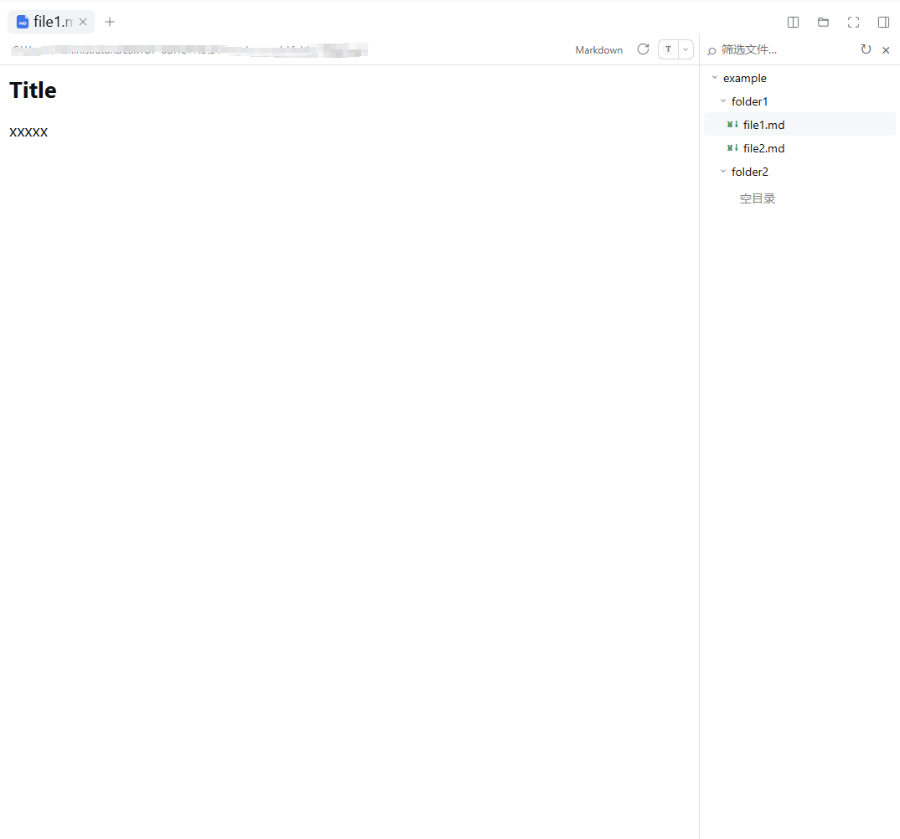

# 文件树 File Tree

为 **DeepSeek Harness（DSH）** 的原生预览面板添加工作区文件树，在右侧浏览目录，点击文件即可打开预览。



## 安装

**桌面版应用**：打开 **「添加插件」**，安装源选择 **npm 官方源**，填写下面的包名并安装：

```text
@xiaotuchu/dsh-file-tree
```

安装或更新后，完全退出并重新打开 DSH。进入会话，打开右侧预览面板，即可使用文件树。标题栏的文件夹按钮可显示或隐藏文件树。

## 功能

- **浏览目录**：展示当前会话的工作区，点击文件夹展开或折叠子目录。
- **打开文件**：点击文件，在旁边的原生预览面板中打开，文件树保持可见。
- **保留浏览位置**：同一会话切换预览标签时，保留目录展开状态和选中文件；切换会话时更新工作区。
- **筛选文件**：输入关键词筛选已加载的文件，不递归搜索尚未展开的目录。
- **刷新列表**：新增或删除文件后，点击刷新按钮更新目录内容。
- **调整宽度**：拖动文件树左侧分隔线，自由调整面板宽度。
- **键盘操作**：支持上下方向键移动、左右方向键展开与折叠，以及 Home / End 跳转。
- **跟随主题**：字体、配色和工具提示与 DSH 界面保持一致。
